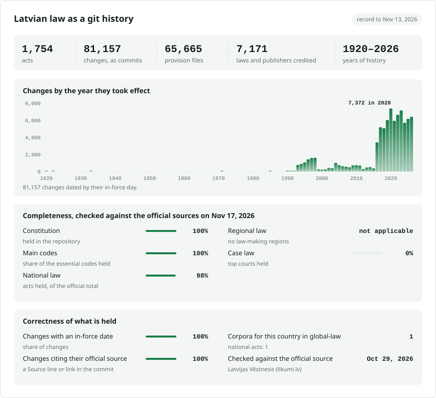

# Latvia: law history in git

**English** · **[Vai lasiet latviski](README.md)**

<picture>
<source media="(prefers-color-scheme: dark)" srcset="data/effort-dark.svg">

</picture>

The law of Latvia as a git history: one file per provision, one commit per amending law on the day its change took effect, and the law that made each change as the commit's author. `git blame` names the law behind every paragraph; `git log` lists every change to an article; picking a date gives the text in force that day.

Part of [lexifina/global-law](https://github.com/lexifina/global-law), one git history for every country's law: this is Latvia's national law, which global-law reads at `latvia/national/acts/`.

**What is in it now:** the Satversme (the Constitution, 1922) and three laws, the Krimināllikums (Criminal Law), the Darba likums (Labour Law) and the Fizisko personu datu apstrādes likums (Personal Data Processing Law), with 132 versions from 7 November 1922 to 15 October 2026, and the 126 amending laws that made them; and 5,827 records of the national measures Latvia has notified to the EU as transposing 1,700 EU directives and other EU acts, dated by their entry into force from 1971 to 2026 (`eu-nim/`, metadata from the EU Publications Office, no text). Each act's folder has a `README.md` that lists every provision, how often it changed and when.

Each act is a folder of provisions (`darba-likums/pants-149.md` is article 149 of the Darba likums, on annual paid leave); `nodala-08.md` is the heading of chapter VIII, `satversme/ievads.md` the preamble of the Satversme and `parejas-noteikumi-024.md` item 24 of the transitional provisions.

The text is in Latvian, as likumi.lv consolidates it. An English translation is not part of this record.

## Questions as git commands

| Question | Command |
| --- | --- |
| Every change to article 149 of the Labour Law | `git log -p --word-diff -- darba-likums/pants-149.md` |
| Which law wrote each line of article 149? | `git blame darba-likums/pants-149.md` |
| Every version of the Labour Law, with the day each took effect | `git log --format="%h %(trailers:key=In-force,valueonly,separator=) %an" -- darba-likums` |
| Article 149 as in force on 1 January 2010 | `python tools/on.py 2010-01-01 darba-likums pants-149` |

**Outside git**, we also host this record publicly, for free:

- **[Ask Claude about Latvian law](https://global-law.lexifina.com/v1/try_claude?country=latvia)**: opens Claude with a first question ready.
- **[Ask ChatGPT](https://global-law.lexifina.com/v1/try_chatgpt?country=latvia)**: the same question in ChatGPT.
- **[Search Latvian law on our site](https://lexifina.com/law?country=latvia&q=ikgad%C4%93jais+apmaks%C4%81tais+atva%C4%BCin%C4%81jums)**: a search for "ikgadējais apmaksātais atvaļinājums", with each provision's text and its versions, no account needed.
- **[Developer REST API](https://global-law.lexifina.com/v1/search_law?query=ikgad%C4%93jais+apmaks%C4%81tais+atva%C4%BCin%C4%81jums&jurisdiction=latvia)**: the same search as JSON, with no key. See the [documentation here](https://lexifina.com/api/global-law).

Both assistants read the record through the free Global law connector (MCP, `https://global-law.lexifina.com/mcp`); the first time, the chat gives you the link that adds it. Ask in Latvian or in English.

**Host it yourself easily.** All it takes is git and Python, and the tools run on your machine:

```sh
git clone --depth 1 https://github.com/lexifina/global-law && cd global-law
python3 tools/countries.py add latvia/national/acts
python3 tools/law.py show 2026-01-01 latvia/national/acts/darba-likums/pants-149.md
```

Opened in Claude Code, Cursor, VS Code or Codex, the clone also starts a local MCP server with the same tools ([MCP.md](https://github.com/lexifina/global-law/blob/main/MCP.md)).

## Dates

Each commit is dated at noon, Europe/Riga, on the day the change took effect, and carries it in its `In-force:` trailer:

- the day is the one likumi.lv gives: each consolidated version ("redakcija") starts on its in-force day, and each changed article carries a note such as "(30.04.2002. likuma redakcijā, kas stājas spēkā 05.11.2002.)"; a version is never dated by its publication;
- where likumi.lv shows a change before its day (article 18 of the Satversme, shown from 24 May 2002 and in force on 5 November 2002), the change is committed on its in-force day;
- git cannot store dates before 1970, so the 3 commits of 1922 and 1933 are dated 1 January 1970, a second apart, with the real day in `In-force:`. Ask for a date with `tools/on.py`, not `git log --before`.

Each change is credited to the law that made it, as likumi.lv's note for that day names it (`Saeimas 16.06.2022. likums`); the first version of each act is the act as enacted, credited to it. The 6 changes no note explains are credited to the publisher, `Latvijas Vēstnesis (likumi.lv)`, and labelled "unexplained".

## How it is checked

- `tools/check_repo.py` reads every version of every act (132 of 4) back from git on the day it took effect and on the day before; both must match the corpus. Results are in [`REPRODUCE.md`](REPRODUCE.md).
- Each version names its source page (an Internet Archive capture of likumi.lv, or the gazette page) and the sha256 of the bytes read; the page's own version selector must name that version.
- Replaying every version must give the newest archived likumi.lv page of each act exactly, provision by provision (`tools/verify.py`).
- History is append-only: no merge commits, no commit dated in the future, every commit's trailers parse, and a second build from the same corpus gave identical hashes.
- [vulnerabilities/](vulnerabilities/README.en.md): possible drafting mistakes in this law, found by global-law's detectors and checked by hand. Not run yet.

## What it does not show

- **Most Latvian law.** Only these four acts are here: other laws, Cabinet regulations, local regulations, case law and treaties are not.
- **Five versions likumi.lv lists**: one of the Criminal Law (9 April 2014) and four of the Labour Law (8 April 2005, 4 May 2011, 1 January 2020, 1 June 2022), of which no usable capture is archived; a change made then shows on the next version, unless an article's note gives its day.
- **likumi.lv's base versions** of the Criminal Law, the Labour Law and the Personal Data Processing Law: no capture is archived, so each first version is the act as published in the official gazette.
- **The Satversme's interruption.** It is kept as in force from 1922; the coup of 1934 and the occupation (1940-1990) changed no words, so they are not commits.
- **Notes and editorial material** of likumi.lv (amendment notes, "PIEZĪMES", placeholders for provisions not yet in force) are not law text and are not in the files.
- **Court rulings.** A Satversmes tiesa judgment that voids a provision shows only when likumi.lv's consolidated text changes.

## Sources

| Source | Kind | Past versions | Notes |
| --- | --- | --- | --- |
| [likumi.lv](https://likumi.lv) (VSIA "Latvijas Vēstnesis") | Official publisher's consolidated legislation | yes, every version with its in-force day | Read through Internet Archive captures; its consolidated texts are for information |
| [Latvijas Vēstnesis](https://www.vestnesis.lv) | Official gazette | the act as published | Amending laws' titles and publication; the first versions of three acts |
| [Internet Archive](https://web.archive.org/) | Web archive | the captures it holds | Every likumi.lv page read is a capture pinned by its timestamp |

## Licence

See [`LICENSE`](LICENSE). Laws and other normative acts are not protected by copyright in Latvia (Autortiesību likums, art. 6); Latvijas Vēstnesis states that re-use of officially published information is to be agreed with it in writing, and no such agreement has been made. The arrangement, tables, commit messages and tools are by Lexifina, under CC BY 4.0.

No AI model wrote, translated or changed legal text; the scripts were written by an AI model, Claude Opus 5.5 (see [`REPRODUCE.md`](REPRODUCE.md)).

## Visualisations

- [visualisations/](visualisations/README.en.md): charts drawn from this repository. Not drawn yet.

## More

From [lexifina/global-law](https://github.com/lexifina/global-law):

- [FEATURES.md](https://github.com/lexifina/global-law/blob/main/FEATURES.md): every feature, and what every corpus must support (`git blame`, `law.py`, the MCP tools)
- [FAQ.md](https://github.com/lexifina/global-law/blob/main/FAQ.md): questions and answers · [CONTRIBUTING.md](https://github.com/lexifina/global-law/blob/main/CONTRIBUTING.md): proposing changes · [MCP.md](https://github.com/lexifina/global-law/blob/main/MCP.md): the MCP server · [REPRODUCE.md](https://github.com/lexifina/global-law/blob/main/REPRODUCE.md): how it was built · [CHANGELOG.md](https://github.com/lexifina/global-law/blob/main/CHANGELOG.md)
- [FRESHNESS.md](https://github.com/lexifina/global-law/blob/main/FRESHNESS.md): how current each corpus is · [Monitoring](https://github.com/lexifina/global-law/tree/main/monitoring): whether updates are running · [WATCHING.md](https://github.com/lexifina/global-law/blob/main/WATCHING.md): how each official source is watched for changes
- [performance/](https://github.com/lexifina/global-law/tree/main/performance): how fast the tools are, measured
- [visualisations/](https://github.com/lexifina/global-law/tree/main/visualisations): charts and bridges across the world's law
- [Vulnerabilities](https://github.com/lexifina/global-law/tree/main/vulnerabilities): mistakes in legislation as published
