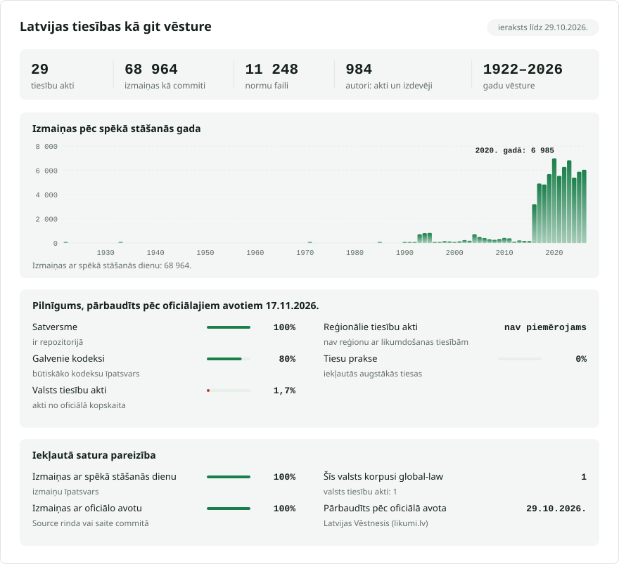

# Latvija: tiesību aktu vēsture git repozitorijā

**Latviešu** · **[Or read it in English](README.en.md)**

<picture>
<source media="(prefers-color-scheme: dark)" srcset="data/lv/effort-dark.svg">

</picture>

Latvijas tiesības kā git vēsture: katrai struktūrvienībai savs fails, katram grozījumu likumam viena revīzija (commit) dienā, kad tā izdarītais grozījums stājās spēkā, un revīzijas autors ir likums, kas grozījumu izdarīja. `git blame` katrai rindkopai norāda likumu, no kura tā cēlusies; `git log` uzskaita visus panta grozījumus; izvēloties datumu, iegūst tajā dienā spēkā esošo tekstu.

Daļa no [lexifina/global-law](https://github.com/lexifina/global-law), vienotas visu valstu tiesību git vēstures: šeit ir Latvijas nacionālās tiesības, kuras global-law lasa no `latvia/national/acts/`.

**Kas tajā ir pašlaik:** Satversme (1922) un Krimināllikums, Darba likums un Fizisko personu datu apstrādes likums, kā arī vēl 25 likumi, to vidū procesuālie kodeksi, Komerclikums un galvenie nodokļu likumi, ar redakcijām, ko likumi.lv publicē kopš katra likuma pirmās konsolidācijas (`likumi/<akts>/`); 5 827 ieraksti par valsts pasākumiem, kurus Latvija paziņojusi Eiropas Savienībai kā 1 700 ES direktīvu un citu ES aktu pārņemšanu, datēti pēc spēkā stāšanās dienas no 1971. līdz 2026. gadam (`eu-nim/`, ES Publikāciju biroja metadati, bez teksta); 59 442 Saeimas sēžu ieraksti no 2016. līdz 2026. gadam: balsojumi ar katra deputāta balsi, darba kārtības punkti un runātāji (`saeima/`, data.gov.lv, CC0); un 2 216 „Latvijas Vēstneša” publikācijas no 1993. līdz 1995. gadam, teksts kā publicēts (`vestnesis/`, papildina katru dienu). Satversmes, Krimināllikuma, Darba likuma un Fizisko personu datu apstrādes likuma mapē ir `README.md`, kurā uzskaitītas visas akta struktūrvienības, cik bieži tās grozītas un kad.

Katrs akts ir struktūrvienību mape (`likumi/darba-likums/pants-149.md` ir Darba likuma 149. pants par ikgadējo apmaksāto atvaļinājumu); `nodala-08.md` ir VIII nodaļas virsraksts, `satversme/ievads.md` ir Satversmes ievads un `parejas-noteikumi-024.md` ir pārejas noteikumu 24. punkts. Līdz 2026. gada 17. novembrim katra likuma mape bija repozitorija saknē (`darba-likums/`); `git log --follow` seko pārvietošanai, un [`data/paths.json`](data/paths.json) katrai vecajai mapei norāda jauno.

Teksts ir latviešu valodā, kā to konsolidē likumi.lv. Tulkojums angļu valodā nav šī ieraksta daļa.

## Jautājumi kā git komandas

| Jautājums | Komanda |
| --- | --- |
| Visi Darba likuma 149. panta grozījumi | `git log -p --follow --word-diff -- likumi/darba-likums/pants-149.md` |
| Kurš likums uzrakstīja katru 149. panta rindu? | `git blame likumi/darba-likums/pants-149.md` |
| Visas Darba likuma redakcijas ar dienu, kad katra stājās spēkā | `git log --format="%h %(trailers:key=In-force,valueonly,separator=) %an" -- likumi/darba-likums` |
| 149. pants redakcijā, kas bija spēkā 2010. gada 1. janvārī | `python tools/on.py 2010-01-01 darba-likums pants-149` |

**Ārpus git** šo ierakstu arī publiski un bez maksas uzturam:

- **[Jautājiet Claude par Latvijas tiesībām](https://global-law.lexifina.com/v1/try_claude?country=latvia)**: atver Claude ar sagatavotu pirmo jautājumu.
- **[Jautājiet ChatGPT](https://global-law.lexifina.com/v1/try_chatgpt?country=latvia)**: tas pats jautājums ChatGPT.
- **[Meklējiet Latvijas tiesību aktos mūsu vietnē](https://lexifina.com/law?country=latvia&q=ikgad%C4%93jais+apmaks%C4%81tais+atva%C4%BCin%C4%81jums)**: meklēšana pēc vārdiem "ikgadējais apmaksātais atvaļinājums", ar katras normas tekstu un tās redakcijām, bez konta.
- **[REST API izstrādātājiem](https://global-law.lexifina.com/v1/search_law?query=ikgad%C4%93jais+apmaks%C4%81tais+atva%C4%BCin%C4%81jums&jurisdiction=latvia)**: tā pati meklēšana JSON formātā, bez atslēgas. Dokumentācija ir [šeit](https://lexifina.com/api/global-law).

Abi asistenti lasa ierakstu ar bezmaksas savienotāja Global law starpniecību (MCP, `https://global-law.lexifina.com/mcp`); pirmajā reizē tērzēšana dod saiti, ar kuru savienotāju pievieno. Jautājiet latviski vai angliski.

**Viegli uzturiet to paši.** Pietiek ar git un Python, un rīki darbojas jūsu datorā:

```sh
git clone --depth 1 https://github.com/lexifina/global-law && cd global-law
python3 tools/countries.py add latvia/national/acts
python3 tools/law.py show 2026-01-01 latvia/national/acts/likumi/darba-likums/pants-149.md
```

Atvērts Claude Code, Cursor, VS Code vai Codex vidē, klons palaiž arī lokālu MCP serveri ar tiem pašiem rīkiem ([MCP.md](https://github.com/lexifina/global-law/blob/main/MCP.md)).

## Datumi

Katras revīzijas datums ir pusdienlaiks pēc Rīgas laika (Europe/Riga) dienā, kad grozījums stājās spēkā, un šī diena ir norādīta tās trailer laukā `In-force:`:

- diena ir tā, ko norāda likumi.lv: katra konsolidētā redakcija sākas tās spēkā stāšanās dienā, un katram grozītajam pantam ir piezīme, piemēram, "(30.04.2002. likuma redakcijā, kas stājas spēkā 05.11.2002.)"; redakcija nekad netiek datēta ar publicēšanas dienu;
- ja likumi.lv grozījumu rāda pirms tā dienas (Satversmes 18. pants, kas redzams no 2002. gada 24. maija, bet stājās spēkā 2002. gada 5. novembrī), grozījums tiek ierakstīts tā spēkā stāšanās dienā;
- git nevar saglabāt datumus pirms 1970. gada, tāpēc 3 revīzijas no 1922. un 1933. gada ir datētas ar 1970. gada 1. janvāri ar vienas sekundes starpību, bet īstā diena ir laukā `In-force:`. Datumu vaicājiet ar `tools/on.py`, nevis ar `git log --before`.

Katrs grozījums tiek attiecināts uz likumu, kas to izdarīja, kā to attiecīgās dienas piezīmē nosauc likumi.lv (`Saeimas 16.06.2022. likums`); katra akta pirmā redakcija ir akts pieņemtajā redakcijā, un tā attiecināta uz pašu aktu. Sešas izmaiņas, ko nepaskaidro neviena piezīme, tiek attiecinātas uz izdevēju `Latvijas Vēstnesis (likumi.lv)` un apzīmētas kā "unexplained" (neizskaidrotas).

## Kā tas pārbaudīts

- `tools/check_repo.py` nolasa katra akta katru redakciju (132 redakcijas, 4 akti) no git tās spēkā stāšanās dienā un iepriekšējā dienā; abām jāsakrīt ar korpusu. Rezultāti ir [`REPRODUCE.md`](REPRODUCE.md).
- Katrai redakcijai ir norādīta tās avota lapa (likumi.lv kopija Internet Archive vai oficiālā izdevuma lapa) un nolasīto baitu sha256; lapas redakciju izvēlnē jābūt norādītai tieši šai redakcijai.
- Secīgi piemērojot visas redakcijas, jāiegūst tieši katra akta jaunākā arhivētā likumi.lv lapa, struktūrvienību pa struktūrvienībai (`tools/verify.py`).
- Vēsture tikai papildinās: nav sapludināšanas revīziju (merge commits), nav nākotnē datētu revīziju, katras revīzijas trailer lauki ir parsējami, un otrā būve no tā paša korpusa deva identiskas jaucējvērtības (hash).
- [vulnerabilities/](vulnerabilities/): iespējamas redakcionālas kļūdas šajās tiesībās, ko atrod global-law detektori un pārbauda ar roku. Vēl nav palaists.

## Ko tas neparāda

- **Lielāko daļu Latvijas tiesību.** Šeit ir tikai šie četri akti: citu likumu, Ministru kabineta noteikumu, pašvaldību saistošo noteikumu, tiesu nolēmumu un starptautisko līgumu šeit nav.
- **Piecas likumi.lv uzskaitītas redakcijas**: vienu Krimināllikuma (2014. gada 9. aprīlis) un četras Darba likuma (2005. gada 8. aprīlis, 2011. gada 4. maijs, 2020. gada 1. janvāris, 2022. gada 1. jūnijs), kurām nav arhivētas izmantojamas kopijas; tad izdarīts grozījums parādās nākamajā redakcijā, ja vien panta piezīme nenorāda tā dienu.
- **likumi.lv bāzes redakcijas** Krimināllikumam, Darba likumam un Fizisko personu datu apstrādes likumam: to kopijas nav arhivētas, tāpēc katra akta pirmā redakcija ir akts tādā veidā, kādā tas publicēts oficiālajā izdevumā.
- **Satversmes darbības pārtraukumu.** Tā saglabāta kā spēkā esoša no 1922. gada; 1934. gada apvērsums un okupācija (1940-1990) negrozīja nevienu vārdu, tāpēc tie nav revīzijas.
- **likumi.lv piezīmes un redakcionālos materiālus** (grozījumu piezīmes, "PIEZĪMES", vietturus vēl spēkā nestājušām normām): tie nav tiesību akta teksts un failos nav iekļauti.
- **Tiesu nolēmumus.** Satversmes tiesas spriedums, ar kuru norma atzīta par spēkā neesošu, parādās tikai tad, kad mainās likumi.lv konsolidētais teksts.

## Avoti

| Avots | Veids | Iepriekšējās redakcijas | Piezīmes |
| --- | --- | --- | --- |
| [likumi.lv](https://likumi.lv) (VSIA "Latvijas Vēstnesis") | Oficiālā izdevēja konsolidētie tiesību akti | jā, katra redakcija ar tās spēkā stāšanās dienu | Nolasīts no Internet Archive kopijām; tā konsolidētie teksti ir informatīvi |
| [Latvijas Vēstnesis](https://www.vestnesis.lv) | Oficiālais izdevums | akts publicētajā redakcijā | Grozījumu likumu nosaukumi un publikācija; triju aktu pirmās redakcijas |
| [Internet Archive](https://web.archive.org/) | Tīmekļa arhīvs | tajā glabātās kopijas | Katra nolasītā likumi.lv lapa ir kopija, kas fiksēta ar tās laika zīmogu |

## Licence

Sk. [`LICENSE`](LICENSE). Latvijā uz likumiem un citiem normatīvajiem aktiem autortiesības neattiecas (Autortiesību likuma 6. pants); "Latvijas Vēstnesis" norāda, ka oficiāli publicētās informācijas atkalizmantošana rakstiski jāsaskaņo ar to, un šāda vienošanās nav noslēgta. Izkārtojums, tabulas, revīziju ziņojumi un rīki ir Lexifina darbs, un uz tiem attiecas CC BY 4.0 licence.

Neviens MI modelis nav rakstījis, tulkojis vai mainījis juridisko tekstu; skriptus uzrakstīja MI modelis Claude Opus 5.5 (sk. [`REPRODUCE.md`](REPRODUCE.md)).

Šis ir angļu versijas ([README.en.md](README.en.md)) tulkojums; ja tās atšķiras, noteicošā ir angļu versija.

## Vizualizācijas

- [visualisations/](visualisations/): diagrammas, kas veidotas no šīs krātuves. Vēl nav uzzīmētas.

## Vairāk

No repozitorija [lexifina/global-law](https://github.com/lexifina/global-law) (angļu valodā):

- [FEATURES.md](https://github.com/lexifina/global-law/blob/main/FEATURES.md): visas funkcijas un tas, kas katram korpusam jāatbalsta (`git blame`, `law.py`, MCP rīki)
- [FAQ.md](https://github.com/lexifina/global-law/blob/main/FAQ.md): jautājumi un atbildes · [CONTRIBUTING.md](https://github.com/lexifina/global-law/blob/main/CONTRIBUTING.md): kā ierosināt izmaiņas · [MCP.md](https://github.com/lexifina/global-law/blob/main/MCP.md): MCP serveris · [REPRODUCE.md](https://github.com/lexifina/global-law/blob/main/REPRODUCE.md): kā tas izveidots · [CHANGELOG.md](https://github.com/lexifina/global-law/blob/main/CHANGELOG.md)
- [FRESHNESS.md](https://github.com/lexifina/global-law/blob/main/FRESHNESS.md): cik aktuāls ir katrs korpuss · [Uzraudzība](https://github.com/lexifina/global-law/tree/main/monitoring): vai atjauninājumi darbojas · [WATCHING.md](https://github.com/lexifina/global-law/blob/main/WATCHING.md): kā katrs oficiālais avots tiek uzraudzīts, lai pamanītu izmaiņas
- [performance/](https://github.com/lexifina/global-law/tree/main/performance): cik ātri darbojas rīki, izmērīts
- [visualisations/](https://github.com/lexifina/global-law/tree/main/visualisations): diagrammas un saiknes visas pasaules tiesībās
- [Ievainojamības](https://github.com/lexifina/global-law/tree/main/vulnerabilities): kļūdas tiesību aktos tādos, kādi tie publicēti
