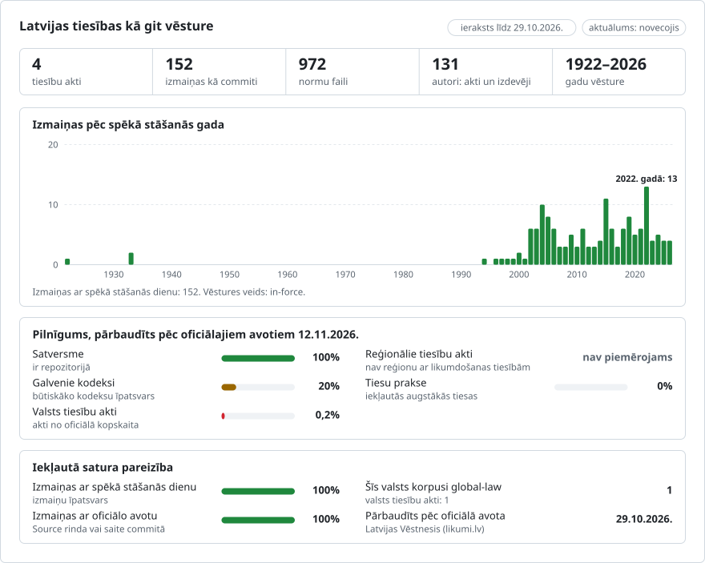

# Latvija: tiesību aktu vēsture git repozitorijā

**Latviešu** · [English](README.en.md)

<picture>
<source media="(prefers-color-scheme: dark)" srcset="data/lv/effort-dark.svg">

</picture>

Daļa no [lexifina/global-law](https://github.com/lexifina/global-law), kas ir vienota visu valstu tiesību git vēsture: šeit ir Latvijas nacionālās tiesības, kuras global-law lasa no `latvia/national/acts/`.

Latvijas tiesību akti kā git vēsture: katrai akta struktūrvienībai ir savs fails, katram likumam ir viena revīzija (commit) dienā, kad tā izdarītais grozījums stājās spēkā, un revīzijas autors ir likums, kas šo grozījumu izdarīja. `git blame` katrai rindai norāda likumu, no kura tā cēlusies; `git log` uzskaita visus panta grozījumus; izvēloties datumu, iegūst tajā dienā spēkā esošo tekstu.

Tas atbilst [lexifina/global-law](https://github.com/lexifina/global-law) kopīgajai struktūrai, kurā tam paredzēta vieta `lv/`.

**Kas tajā ir pašlaik**

| Mape | Akts | Redakcijas | Vēsture |
| --- | --- | ---: | --- |
| `satversme/` | Latvijas Republikas Satversme (1922) | 17 | Satversmes sapulces pieņemtā redakcija (spēkā no 1922. gada 7. novembra), 1933. gada grozījums un visi grozījumi no 1994. gada līdz tam, kas ir spēkā no 2019. gada 1. janvāra un joprojām ir spēkā |
| `kriminallikums/` | Krimināllikums (1998) | 83 | No pieņemtās redakcijas (spēkā no 1999. gada 1. aprīļa) līdz redakcijai, kas ir spēkā 2026. gada 15. oktobrī, ietverot visas likumi.lv uzskaitītās konsolidētās redakcijas, izņemot vienu |
| `fizisko-personu-datu-apstrades-likums/` | Fizisko personu datu apstrādes likums (2018) | 3 | No pieņemtās redakcijas (spēkā no 2018. gada 5. jūlija) līdz šodienai, ietverot abus grozījumu likumus |
| `darba-likums/` | Darba likums (2001) | 29 | No pieņemtās redakcijas (spēkā no 2002. gada 1. jūnija) līdz redakcijai, kas ir spēkā no 2024. gada 22. oktobra un joprojām ir spēkā, ietverot visas likumi.lv uzskaitītās konsolidētās redakcijas, izņemot četras |

Teksts ir latviešu valodā, kas ir valsts valoda. Konsolidētās redakcijas ir ņemtas no [likumi.lv](https://likumi.lv), Latvijas Republikas oficiālā izdevēja VSIA "Latvijas Vēstnesis" tiesību aktu vietnes. likumi.lv norāda, ka tās konsolidētie teksti ir informatīvi; oficiālā publikācija ir oficiālajā izdevumā *Latvijas Vēstnesis* ([vestnesis.lv](https://www.vestnesis.lv)), kurā tika publicēts katrs grozījumu likums. Katras mapes `README.md` failā uzskaitītas visas attiecīgā akta struktūrvienības, cik bieži tās grozītas un kad.

## Jurista jautājumi kā git komandas

| Jautājums | Komanda |
| --- | --- |
| Kā skanēja Satversmes 18. pants 2002. gada 1. jūnijā? | `python tools/on.py 2002-06-01 satversme pants-018` |
| Tas pats tikai ar git (bash) | `git show $(git rev-list -1 --before="2002-06-01T23:59:59Z" main -- satversme/pants-018.md):satversme/pants-018.md` |
| Tas pats PowerShell vidē | `$r = git rev-list -1 --before="2002-06-01T23:59:59Z" main -- satversme/pants-018.md; git show "$($r):satversme/pants-018.md"` |
| Kurš likums ir katras Krimināllikuma 36. panta daļas autors? | `git blame kriminallikums/pants-036.md` |
| Visi Satversmes ievada grozījumi, vārdu pa vārdam | `git log -p --word-diff satversme/ievads.md` |
| Visi ierakstītie likumi pēc kārtas | `git log --reverse --format="%ad %an" --date=short main` |
| Viss, ko grozīja viens likums | `git show law/likums-2014-06-19-267428` (birkas `law/<key>`; atslēga ir likuma pieņemšanas diena un tā identifikators likumi.lv) |
| Viss akts noteiktā datumā | `python tools/on.py 2015-01-01 kriminallikums` |
| Akts redakcijas spēkā stāšanās dienā | `git show satversme/1998-11-06` (birkas `<act>/<in-force day>`) |

Failu nosaukumi: `pants-018.md` ir 18. pants, `pants-070-11.md` ir 70.¹¹ pants, `nodala-08.md` ir VIII nodaļas virsraksts, `ievads.md` ir ievads, `parejas-noteikumi-024.md` ir pārejas noteikumu 24. punkts, un `zz-*.md` ir noslēguma rindas (pieņemšana, paraksti). Pēc repozitorija pārbūves atjauniniet birkas ar `git fetch --force --tags`: parasts fetch saglabā novecojušas birkas.

## Datumi

- Katras revīzijas datums ir **pusdienlaiks pēc Rīgas laika (Europe/Riga) dienā, kad grozījums stājās spēkā**. Diena ir norādīta trailer laukā `In-force:`, ko nolasa rīki.
- **Diena ir tā, ko norāda likumi.lv**: katra konsolidētā redakcija sākas tās spēkā stāšanās dienā, un katram grozītajam pantam ir piezīme, piemēram, "(30.04.2002. likuma redakcijā, kas stājas spēkā 05.11.2002.)". Likums stājas spēkā četrpadsmit dienas pēc izsludināšanas, ja likumā nav noteikts cits termiņš (Satversmes 69. pants); likumi.lv piemēro šo noteikumu vai paša likuma noteikumu, tāpēc šeit neviens no tiem netiek piemērots.
- **Grozījums parādīts pirms tā dienas.** likumi.lv 2002. gada 24. maija redakcijā jau ir redzams jaunais 18. pants (Saeimas deputātu zvērests) ar piezīmi, ka tas stājas spēkā 2002. gada 5. novembrī. Šeit 18. pantā līdz 2002. gada 5. novembrim saglabājas iepriekšējais teksts, un šai dienai ir sava revīzija.
- **Pirms 1970. gada.** Git nevar saglabāt datumus pirms 1970. gada, tāpēc 1922. un 1933. gada revīzijas ir datētas ar 1970. gada 1. janvāri ar vienas sekundes starpību; īstā diena ir norādīta trailer laukā `In-force:` un birkās.
- `--before="YYYY-MM-DD"` bez laika izmanto jūsu pulksteņa diennakts laiku, tāpēc pirms pusdienlaika var tikt izlaists grozījums, kas stājās spēkā tajā dienā. Izmantojiet `T23:59:59Z`, kā parādīts iepriekš, vai rīku.

## Kā tas pārbaudīts

- **Salīdzinājumā ar šodienas tekstu.** Katra akta jaunākajā arhivētajā likumi.lv lapā (iegūta 2026. gada 18. un 19. oktobrī un 3. oktobrī) redzama spēkā esošā redakcija. Secīgi piemērojot visas šajā ierakstā esošās redakcijas, iegūst tieši šo lapu, struktūrvienību pa struktūrvienībai: 125 Satversmes failus, 534 Krimināllikuma failus un 58 Fizisko personu datu apstrādes likuma failus.
- **Katra redakcija ir datēts avots.** Katrai redakcijai ir norādīta tās avota lapa (likumi.lv kopija Internet Archive, kuras adresē ir kopijas iegūšanas laiks, vai oficiālā izdevuma lapa) un to baitu sha256, no kuriem tā nolasīta, un lapas redakciju izvēlnē jābūt norādītai tieši šai redakcijai.
- Katra akta katra redakcija tiek nolasīta no git tās spēkā stāšanās dienā un iepriekšējā dienā (`tools/check_repo.py`); abām jāsakrīt ar `corpus.json`. Rezultāti ir `REPRODUCE.md`.
- Repozitorija stāvokļa pārbaudes: `main` zarā nav sapludināšanas revīziju (merge commits), revīziju datumi nekad neiet atpakaļ, nekas nav datēts nākotnē, un katras revīzijas trailer lauki ir parsējami ar `git interpret-trailers --parse`.
- Repozitorijs tiek otrreiz pārbūvēts no tiem pašiem datiem, un tam jādod identiskas jaucējvērtības (hash).

## Ko nozīmē "autors"

Revīzijas autors ir likums, kas izdarīja grozījumu, ar e-pasta adresi, kas nevar pastāvēt (`likums-2014-06-19-267428@likumi.lv.invalid`), lai `git blame` un `git log --author` to nosauktu. Revīzijas iesniedzējs (committer) vienmēr ir Lexifina.

- **Autorība tiek noteikta tikai pēc avota.** Pants tiek attiecināts uz likumu, ko attiecīgajai dienai norāda likumi.lv piezīme. Ja piezīmē uzskaitīti vairāki likumi, bet datēts ir tikai pēdējais ("Ar grozījumiem, kas izdarīti ar 12.02.2004., … un 13.12.2012. likumu, kas stājas spēkā 01.04.2013."), sarakstā agrāk minētu likumu norāda tikai dienā, ko kāda cita piezīme norāda kā tā spēkā stāšanās dienu. Ja nodaļa aizstāta kopumā (Satversmes VIII nodaļa, 1998), tās panti tiek attiecināti uz likumu ar nodaļas piezīmes starpniecību.
- **Neizskaidroti grozījumi** tiek ierakstīti izdevēja vārdā ar atzīmi "unexplained" (neizskaidrots), ja tos nepaskaidro neviena piezīme. Tādi ir pieci: Satversmes 52. pantā vienīgajā arhivētajā 1922. gada redakcijas kopijā ir "Valsts prezidents", bet visās vēlākajās kopijās un 1993. gada oficiālajā atkārtotajā publikācijā ir "Valsts Prezidents" (parādīts 1933. gada 14. aprīlī); un Krimināllikuma 55. un 58.1 pants 2006. gada 1. janvārī (probācijas dienests), 225. pants 2015. gada 1. janvārī un 289. pants 2022. gada 1. janvārī, kuru piezīmes šo dienu nenorāda.
- **Katra akta pirmā revīzija** ir akts pieņemtajā redakcijā, kas attiecināta uz pašu aktu: Satversmes sapulces 1922. gada 15. februāra Satversme, 1998. gada 17. jūnija Krimināllikums un 2018. gada 21. jūnija Fizisko personu datu apstrādes likums.
- Ievietoto pantu un daļu augšraksta numuri ir saglabāti kā Unicode augšraksta cipari, kā tie drukāti: 70.¹¹, (2²).
- Blame attiecina veselas rindas (viena rindkopa vienā rindā). Lai redzētu, kurus vārdus tieši grozīja katrs likums, izmantojiet `git log -p --word-diff`.

## Ko tas neparāda

- **Satversmes darbības pārtraukums.** Tā ir saglabāta kā spēkā esoša no 1922. gada. Tās darbību pārtrauca 1934. gada apvērsums un okupācija (1940–1990); Augstākā Padome to daļēji atjaunoja 1990. gada 4. maijā, bet pilnībā tā tika atjaunota, kad 1993. gada 6. jūlijā sanāca 5. Saeima. Šie notikumi negrozīja nevienu vārdu, tāpēc tie nav revīzijas.
- **Viena Krimināllikuma redakcija.** likumi.lv uzskaita 2014. gada 9. aprīļa redakciju, bet tās kopija nav arhivēta, un neviena nākamās redakcijas piezīme šo dienu nenorāda; jebkurš tajā dienā izdarītais grozījums parādās 2014. gada 14. jūnijā.
- **Četras Darba likuma redakcijas.** likumi.lv uzskaita 2005. gada 8. aprīļa, 2011. gada 4. maija, 2020. gada 1. janvāra un 2022. gada 1. jūnija redakcijas, kuru lapas nav pieejamas (2020. gada 1. janvāra redakcijai ir tikai kopija, kas izveidota, pirms stājās spēkā tai iepriekšējā redakcija, un tā netiek izmantota). Neviena nākamās redakcijas piezīme šīs dienas nenorāda, tāpēc ierakstā šajās dienās revīziju nav; jebkurš tad izdarītais grozījums parādās nākamajā redakcijā (2020. gada 1. janvāra gadījumā viens pants, kura piezīme norāda šo dienu). 158.–163. pants (E daļa, administratīvā atbildība), ko likumi.lv rāda no 2019. gada 19. novembra, ir ierakstīti 2020. gada 1. jūlijā, dienā, kad tie stājas spēkā saskaņā ar to piezīmēm.
- **Darba likums pieņemtajā redakcijā.** Tā pirmā redakcija ir akts tādā veidā, kādā tas publicēts oficiālajā izdevumā (Latvijas Vēstnesis Nr. 105, 2001. gada 6. jūlijs). Seši panti no vecākās pieejamās likumi.lv redakcijas (2003. gada 1. janvāris) atšķiras tikai ar pareizrakstību un salikumu; šajā dienā tie parādās kā grozījumi, kuriem nav norādīts likums.
- **Bāzes redakcijas likumi.lv.** likumi.lv Krimināllikuma bāzes redakcijas (1999. gada 1. aprīlis) un Fizisko personu datu apstrādes likuma bāzes redakcijas (2018. gada 5. jūlijs) kopija nav arhivēta. To pirmās redakcijas ir akti tādā veidā, kādā tie publicēti oficiālajā izdevumā (Latvijas Vēstnesis Nr. 199/200, 1998. gada 8. jūlijs, un Nr. 132, 2018. gada 4. jūlijs). Oficiālā izdevuma lapā un likumi.lv rindkopas ir izkārtotas atšķirīgi; teksts, kas atšķiras tikai ar atstarpēm vai rindu pārnesumiem, tiek ņemts vēlākajā izkārtojumā un netiek uzskatīts par grozījumu.
- **likumi.lv piezīmes un redakcionālie materiāli** nav tiesību akta teksts un failos nav iekļauti: grozījumu piezīmes, "PIEZĪMES", kurās citēti grozījumu likumu pārejas noteikumi, un vietturi vēl spēkā nestājušām normām ("(Punkts stājas spēkā 01.01.2022. un iekļauts likuma redakcijā uz 01.01.2022. …)"). Struktūrvienība, ko konsolidētais teksts rāda tikai kā "(Izslēgts ar … likumu …)", attiecīgajā dienā tiek izņemta; izslēgtās daļas panta iekšienē saglabā likumi.lv rindu "(izslēgta ar … likumu)".
- **Tiesu nolēmumi.** Satversmes tiesas spriedumi, ar kuriem norma atzīta par spēkā neesošu, parādās tikai tad, kad mainās likumi.lv konsolidētais teksts; šajos četros aktos neviens no tiem nav atsevišķa revīzija.

## Kā tas izveidots

Lexifina nolasa šeit uzskaitītos avotus un vienā korpusa failā ieraksta katra akta datētās redakcijas un likumus, kas izdarīja katru grozījumu. `tools/build.py` no šī faila izveido šo repozitoriju, un viens un tas pats korpuss vienmēr dod vienas un tās pašas revīziju jaucējvērtības; sīkāka informācija un pārbaudes ir `REPRODUCE.md`. Lexifina kodu uzrakstīja modelis (Claude); tas neuzrakstīja nekādu juridisku tekstu, un, veidojot vēsturi, neviens modelis netiek darbināts.

Neviens MI modelis nav rakstījis vai mainījis juridisko tekstu. Skriptus uzrakstīja un avotus izvēlējās Claude Opus 5.5; sk. `REPRODUCE.md`.

## Avoti

| Avots | Veids | Iepriekšējās redakcijas | Norāda grozījumu aktu | API vai lielapjoma lejupielāde | Piezīmes |
| --- | --- | --- | --- | --- | --- |
| [likumi.lv](https://likumi.lv) | Oficiālā izdevēja konsolidētie tiesību akti (VSIA "Latvijas Vēstnesis") | jā, katra redakcija ar tās spēkā stāšanās dienu | jā, piezīme pie katra panta | nē | Izmantots, ar Internet Archive kopiju starpniecību |
| [Latvijas Vēstnesis](https://www.vestnesis.lv) | Oficiālais izdevums | akts publicētajā redakcijā | nav attiecināms | nē | Izmantots: grozījumu likumu publikācija; Krimināllikuma un Fizisko personu datu apstrādes likuma bāzes redakcijas |
| [Internet Archive](https://web.archive.org/) | Tīmekļa arhīvs | tajā glabātās kopijas | nav attiecināms | – | Izmantots: katra nolasītā likumi.lv lapa ir fiksēta kopija |
| – | Tīmekļa arhīvs | nav attiecināms | nav attiecināms | jā | Pārbaudīts: satur tikai likumi.lv pašreizējās lapas |
| [data.gov.lv](https://data.gov.lv) | Atvērto datu portāls | nav attiecināms | nav attiecināms | CKAN API | Pārbaudīts: nav tiesību aktu datu kopas |
| [legalize-lv](https://github.com/legalize-dev/legalize-lv) | Brīvprātīgo git repozitorijs, veidots no likumi.lv | nē, šiem aktiem | nē | nav attiecināms | Pārbaudīts: Krimināllikumam un datu likumam viena revīzija (šodienas teksts), Satversmei 2026. gada momentuzņēmumi; teksts nav ņemts |
| [blame-likumi.lv](https://github.com/viktor-gusev/blame-likumi.lv) | Brīvprātīgo git blame rīks likumi.lv | jā | daļēji | nav attiecināms | Iepriekšējs darbs šajā jomā; nav lasīts, teksts nav kopēts |

Pētniecības ceļveži, kas aptver visas valstis: [GlobaLex](https://www.nyulawglobal.org/globalex/) un [Law Library of Congress Guide to Law Online](https://www.loc.gov/research-centers/law-library-of-congress/researcher-resources/guide-to-law-online/).

## Licence

Latvijā uz likumiem un citiem normatīvajiem aktiem autortiesības neattiecas (Autortiesību likuma 6. pants). Avots: likumi.lv un oficiālais izdevums "Latvijas Vēstnesis", VSIA "Latvijas Vēstnesis". "Latvijas Vēstnesis" norāda, ka oficiāli publicētās informācijas atkalizmantošana rakstiski jāsaskaņo ar oficiālo izdevēju ([vestnesis.lv/atkalizmantosana](https://www.vestnesis.lv/atkalizmantosana)); šāda vienošanās nav noslēgta, un šis repozitorijs ir privāts. Izkārtojums, tabulas, revīziju ziņojumi un rīki ir Lexifina darbs, un uz tiem attiecas `LICENSE` noteikumi.

Šis repozitorijs nav juridiska konsultācija un nav oficiāla publikācija.

Šis ir angļu versijas ([README.en.md](README.en.md)) tulkojums; ja tās atšķiras, noteicošā ir angļu versija.

## Vairāk

No repozitorija [lexifina/global-law](https://github.com/lexifina/global-law) (angļu valodā):

- [FEATURES.md](https://github.com/lexifina/global-law/blob/main/FEATURES.md): visas funkcijas un tas, kas katram korpusam jāatbalsta (`git blame`, `law.py`, MCP rīki)
- [FAQ.md](https://github.com/lexifina/global-law/blob/main/FAQ.md): jautājumi un atbildes · [CONTRIBUTING.md](https://github.com/lexifina/global-law/blob/main/CONTRIBUTING.md): kā ierosināt izmaiņas · [MCP.md](https://github.com/lexifina/global-law/blob/main/MCP.md): MCP serveris · [REPRODUCE.md](https://github.com/lexifina/global-law/blob/main/REPRODUCE.md): kā tas izveidots · [CHANGELOG.md](https://github.com/lexifina/global-law/blob/main/CHANGELOG.md)
- [FRESHNESS.md](https://github.com/lexifina/global-law/blob/main/FRESHNESS.md): cik aktuāls ir katrs korpuss · [Uzraudzība](https://github.com/lexifina/global-law/tree/main/monitoring): vai atjauninājumi darbojas · [WATCHING.md](https://github.com/lexifina/global-law/blob/main/WATCHING.md): kā katrs oficiālais avots tiek uzraudzīts, lai pamanītu izmaiņas
- [performance/](https://github.com/lexifina/global-law/tree/main/performance): cik ātri darbojas rīki, izmērīts
- [visualisations/](https://github.com/lexifina/global-law/tree/main/visualisations): diagrammas un saiknes visas pasaules tiesībās
- [Ievainojamības](https://github.com/lexifina/global-law/tree/main/vulnerabilities): kļūdas tiesību aktos tādos, kādi tie publicēti
